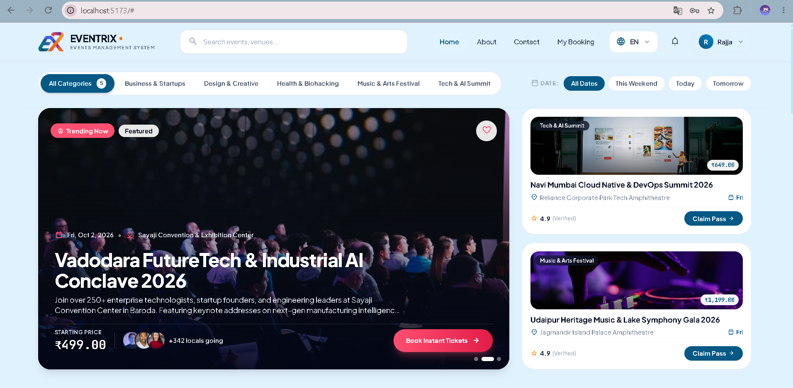
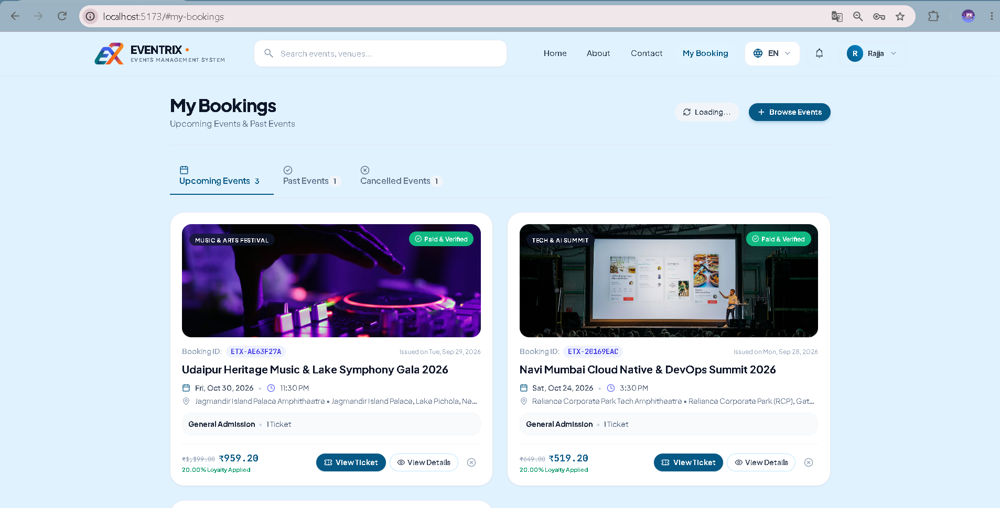
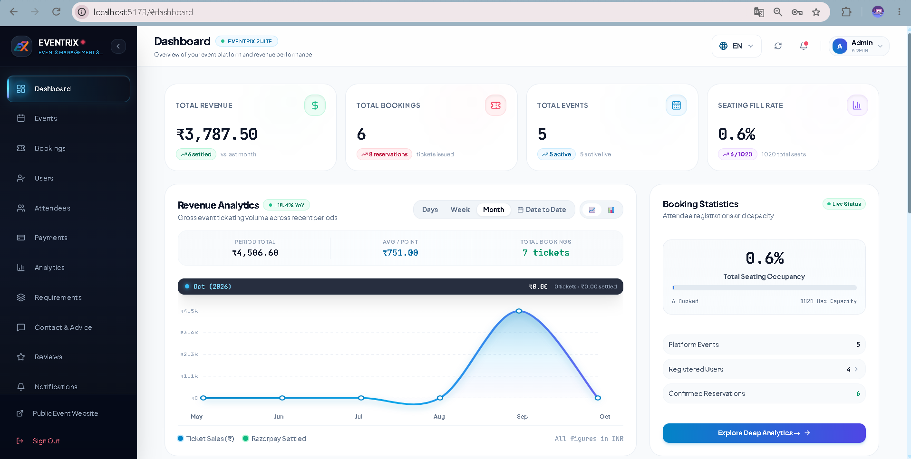

# Eventrix

## Project Description

Eventrix is a modern, full-stack event discovery, booking, and management platform built with Python (Django REST Framework) and React (Vite). It allows users to explore upcoming events, browse categories, view interactive venue locations on a map, book tickets with customized attendee preferences, and make secure payments via Razorpay and Stripe.

The platform includes verified digital PDF ticket generation with QR code stubs, automated email notifications, a returning customer loyalty discount engine, and an organizer/admin dashboard for managing events, attendees, bookings, reviews, and real-time revenue analytics.

## Features

* User Registration & Authentication -- Simple sign-up and login experience with role-based access (Admin, Organizer, Attendee) and personal booking history.
* Event Discovery & Interactive Exploration -- Explore events with category filters, keyword search, schedule dates, interactive city map views, and live capacity tracking.
* Booking & Payment Integration -- Reserve tickets with custom seating and dietary preferences, returning customer loyalty discounts (10%–20% off), and secure payments via Razorpay and Stripe.
* Digital Pass & QR Code Verification -- Automated verified PDF ticket generation with high-contrast QR entry verification and email delivery.
* Organizer & Admin Dashboard -- Comprehensive management tools for creating and editing events, tracking attendee requirements, handling booking fulfillment, and viewing platform analytics.

## Windows

```bash
# 1. Clone the repository
git clone https://github.com/ravi-1820/Eventrix-Event-booking.git
cd Eventrix

# 2. Backend Setup
cd backend

# Create and activate virtual environment
python -m venv venv
venv\Scripts\activate

# Install dependencies
pip install -r requirements.txt

# Run database migrations
python manage.py migrate

# Seed sample data (events, users, bookings)
python scripts/seed_data.py

# Start Django backend server
python manage.py runserver

# 3. Frontend Setup (in a separate terminal)
cd ../frontend

# Install dependencies
npm install

# Start Vite dev server
npm run dev
```

Open `http://localhost:5173/` in your browser.

## macOS / Linux

```bash
# 1. Clone the repository
git clone https://github.com/ravi-1820/Eventrix-Event-booking.git
cd Eventrix

# 2. Backend Setup
cd backend

# Create and activate virtual environment
python3 -m venv venv
source venv/bin/activate

# Install dependencies
pip install -r requirements.txt

# Run database migrations
python3 manage.py migrate

# Seed sample data (events, users, bookings)
python3 scripts/seed_data.py

# Start Django backend server
python3 manage.py runserver

# 3. Frontend Setup (in a separate terminal)
cd ../frontend

# Install dependencies
npm install

# Start Vite dev server
npm run dev
```

Open `http://localhost:5173/` in your browser.

## Credentials :-

* Username :- admin
* Email :- admin@eventrix.com
* Password :- admin123

## Screenshots

### 1. Home Page & Event Discovery


### 2. User Authentication & Login


### 3. My Bookings & Digital Ticket Pass


### 4. Admin Management Dashboard

